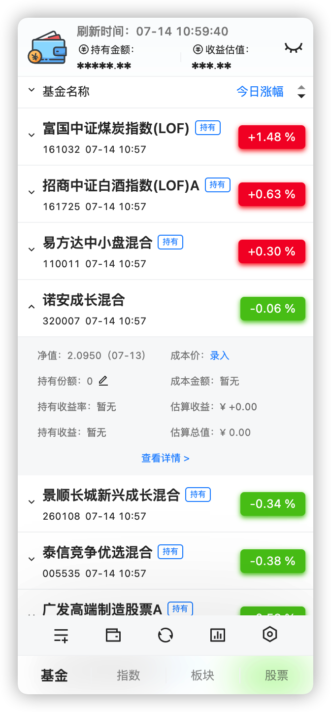
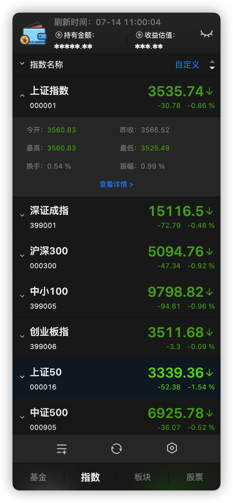
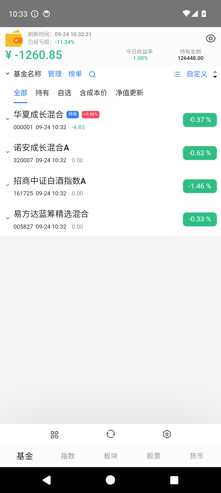
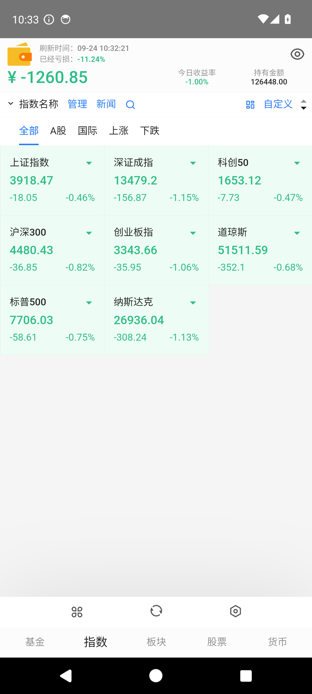
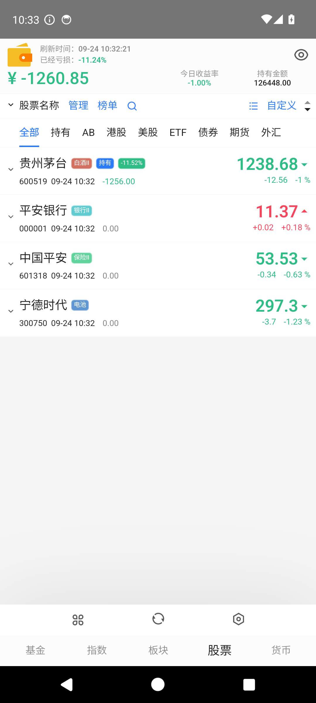
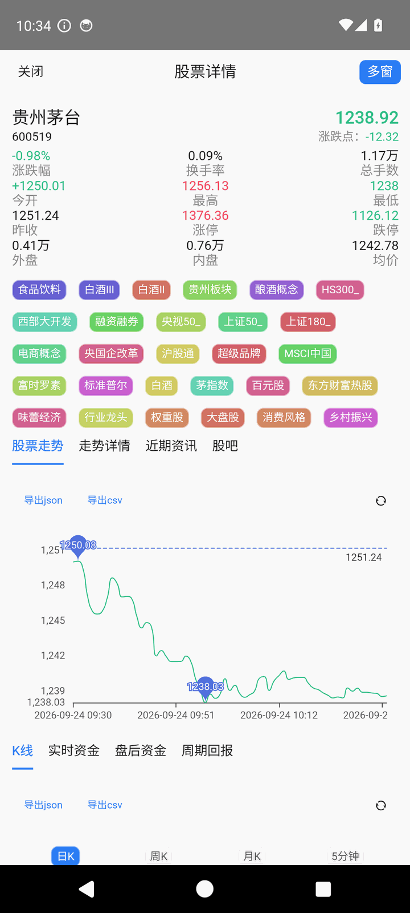
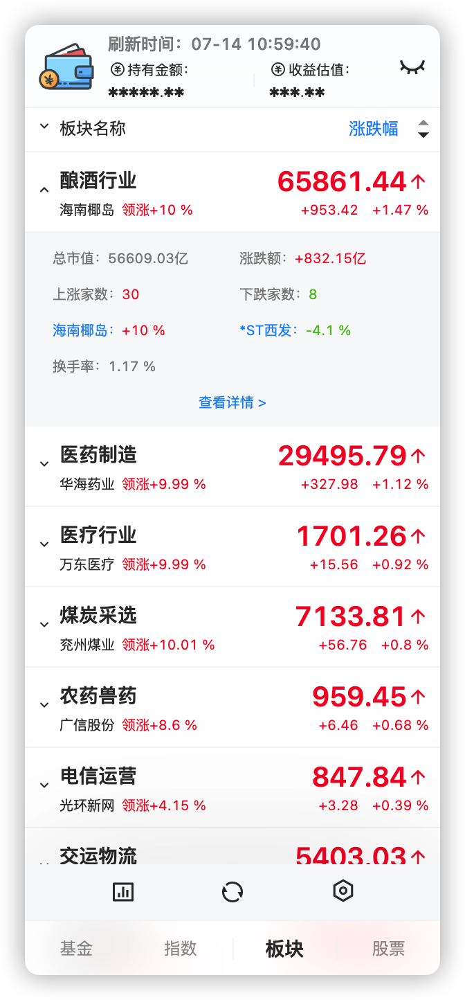

[TOC]

<div style="text-align:center;margin:1.5rem 0">
  
  <p><b>基金 · 股票 · 大盘指数 · 板块 · 加密货币，行情常驻，抬眼可见。</b></p>
  <p>macOS / Windows / Linux 菜单栏小应用 ＋ Android 全屏客户端，四端共用同一份代码，完全开源免费（GPL-3.0）。</p>
  <p>
    <a href="#下载与安装">⬇️ 下载安装</a> ｜
    <a href="https://github.com/thecoolboyhan/fishing-funds">GitHub 仓库</a> ｜
    <a href="https://github.com/thecoolboyhan/fishing-funds/releases">Releases</a>
  </p>
</div>

## 项目简介

**Fishing Funds** 是一款**行情常驻工具**：

- 桌面端常驻系统菜单栏 / 托盘，随手一点就能看行情；
- **自 v8.7.1-fork.1 起新增安卓客户端**，手机上同样随时查看。

支持的内容：

- 基金实时涨跌与**估算收益**（多钱包、持有份额、成本价、收益统计）
- 大盘指数一屏尽览
- 板块涨跌排行
- 个股走势、分时、K 线
- 加密货币行情

数据来源于天天基金、蚂蚁基金、同花顺·爱基金、腾讯证券等公开接口。软件完全开源免费，纯个人自用，仅供学习交流。

> 项目地址：<https://github.com/thecoolboyhan/fishing-funds>
> 当前版本：v8.7.1-fork.1 ｜ 许可证：GPL-3.0 ｜ 技术栈：Electron + React + TypeScript ＋ Capacitor 6

## 截图

### 桌面端（菜单栏常驻）

<p align="center">
  
  &nbsp;
  
</p>

*常驻菜单栏 / 托盘，窗口轻巧不占地方；以上为 macOS 菜单栏小窗实测截图。*

### 移动端（Android）

<p align="center">
  
  &nbsp;
  
  &nbsp;
  
</p>

<p align="center">
  
</p>

*安卓端为全屏应用，触摸友好；首次启动内置 4 只基金 + 4 只股票的示例自选，可直接体验。*

## 功能一览

### 基金：涨跌与估算收益

支持添加基金、标记持有份额与持仓成本价，实时展示今日涨幅、净值、持有收益与估算收益；支持**多钱包**分别管理。


### 指数：一屏看全大盘

上证指数、深证成指、沪深 300、中小 100、创业板指、上证 50、中证 500 等常用指数一屏尽览。


### 板块行情与排行

板块涨跌幅、领涨个股、总市值、涨跌家数、换手率等信息一目了然。



除此之外，还包含：

- **股票 / 虚拟货币**行情展示
- **AI 识别录入**：截图即可批量导入基金
- **导入 / 导出**：JSON 配置随时备份
- **配置同步**：借助 iCloud、OneDrive 实现多设备同步
- **安卓端专属**：全屏适配、触摸友好的字号（基准 13px，可在设置中调到 16px）、首次启动内置示例自选

## v8.7.1-fork.1 更新：安卓客户端来了

`android-capacitor` 分支把同一份渲染层代码装进了 **Capacitor 6 原生壳**，与桌面三端共用全部业务代码，平台差异只通过 `window.contextModules` 桥隔离。四端一份代码，改一处、全端同步。

**本次安卓化过程顺带修掉的问题**（部分同样影响桌面端）：

| 类别 | 问题 | 后果（修复前） |
|---|---|---|
| 存储 | `electronStore` 双重编码：写数组/对象，读回来是字符串 | 钱包配置解析静默失效，新增的自选重启后丢失 |
| 存储 | `storeCover` 参数非法时先 `clear()` 再什么都不写 | 整个命名空间被静默清空（恢复备份会丢全部配置） |
| 网络 | 原生栈被服务端按客户端指纹掐断，而 WebView 的 `fetch` 能通 | 股票 / 指数 / 分时 / K 线数据全空 |
| 时序 | 持久化监听器注册晚于初始化写入 | 首次启动的配置写入全部丢失，永不落盘 |
| 导出 | `saveJsonToCsv` 漏掉所有数据行 | 导出只有 BOM 的空 CSV |
| UI | 移动端 CSS 误伤桌面小窗 | 325px 宽的菜单栏小窗布局错乱 |

其中「**双网络栈互补**」是关键设计：原生 OkHttp 栈与 WebView 浏览器栈能力互补——前者能读无 CORS 头的静态数据，后者在部分接口上能绕过服务端的客户端指纹识别。两者互为兜底，缺一都会丢一半数据。


为什么锚定 v8.7.1？官方 8.8.0 把数据层核心（反爬绕过逻辑）抽成了闭源子模块，仅凭公开源码无法编译；v8.7.1 数据层**完整开源**，可自行构建、自行修复，适合长期自维护。本仓库与上游不再同步，官方自动更新已关闭。


## 下载与安装

所有安装包都发布在 [**GitHub Releases**](https://github.com/thecoolboyhan/fishing-funds/releases)。

### 桌面端（macOS / Windows / Linux）

从 Releases 下载对应平台的安装包即可。


macOS 不允许直接打开未签名程序。若提示「已损坏」或无法打开，可在「系统设置 → 隐私与安全性 → 仍要打开」放行，或执行：

```bash
sudo xattr -d com.apple.quarantine "/Applications/Fishing Funds.app"
```

此类操作涉及运行未签名程序，请自行确认来源可信后再进行。


### 安卓端

1. 下载 Release 里的 `fishing-funds-android-*.apk`；
2. 允许「安装未知来源应用」后安装（自签名包，**不含任何第三方 SDK / 统计**）；
3. 首次启动会内置 4 只基金 + 4 只股票的示例自选，方便直接体验，在界面上删除或替换即可。


debug 包与 release 包**签名不同**，二者切换必须先卸载旧版（会清掉本地配置）。应用升级请使用同一签名的连续版本。


## 数据源

基金估值支持多数据源，可在「设置 → 基金接口」切换。**不同网络环境下可用性不同**，以下为实测记录：

| 数据源 | 评级 | 说明 |
| --- | --- | --- |
| 东方财富 · 天天基金 | ★★★★★ | 推荐，最快且估值最准确；但部分网络出口会被 CDN 拦截 |
| 同花顺 · 爱基金 | ★★★★☆ | 受限网络下的可靠备选 |
| 支付宝 · 蚂蚁基金 | ★★★☆☆ | 可用 |
| 腾讯证券 | ★☆☆☆☆ | 上游接口已下线，暂不可用 |


若基金列表为空、且能确认不是代码问题，先切换数据源试试（如切到「同花顺-爱基金」）。


## 从源码构建

### 桌面端

需要 **Node ≥ 22.8**。

```bash
# 跳过 phantomjs 等会下载二进制的 postinstall
npm install --ignore-scripts

# 单独下载 Electron 运行时
node node_modules/electron/install.js

# 构建，产出 release/app/dist
npm run build

# 打包 macOS dmg（未签名）
npm run package-mac
```

说明：开发热更新 `npm run dev` 依赖 **bun**；而 `build` / `package-*` 只需要 electron-vite + electron-builder，**无需 bun**。

### 安卓端

```bash
npm install
npm run build
npx cap sync android              # 把 web 资源同步进 android/ 工程
cd android && ./gradlew assembleDebug   # 需 JDK 17 + ANDROID_HOME
```

- 发布签名读取 `android/keystore.properties`（与 `*.jks` 均不入库）；文件缺失时自动回退为不签名，构建不会失败；
- 详细步骤、签名密钥管理与发布流程见仓库 [`AGENTS.md`](https://github.com/thecoolboyhan/fishing-funds/blob/android-capacitor/AGENTS.md) §8。

## 系统代理配置

受网络环境影响，部分货币行情接口可能无法直接访问。本应用已适配系统代理，支持 **HTTP 代理**与 **SOCKS 代理**。

只需把下面两个域名加入代理软件规则，然后重启应用即可：

```text
api.coingecko.com
api.coincap.io
```

## AI 识别录入

应用支持用 AI **识别截图导入基金**，需要具备**视觉能力**的大模型（推荐 `gpt-4o`、`grok`、`gemini-2.5-pro`、`qwen2.5vl:32b` 及以上）。

使用方式：

1. 在「设置 → AI」中配置 **OpenAI 兼容接口**的请求地址与 API Key；
2. 进入某宝 → 理财 → 总资产 → 我的资产 → 全部持有，**长截图**，确保包含基金名称、持有收益、累计收益三项数据；
3. 交给应用识别并导入。


使用前请务必了解该功能：请确保接口地址安全，应用不保证识别过程中的数据不会泄露至第三方。你的 API Key 由应用本地保存，不会收集或上传。


## 导入 / 导出

右键菜单支持导入 / 导出基金 JSON 配置，方便备份与迁移。

```typescript
interface FundSetting {
  code: string;   // 基金代码（必填）
  name?: string;  // 基金名称
  cyfe?: number;  // 持有份额
  cbj?: number;   // 持仓成本价
}
```

示例：

```json
[
  { "code": "320007", "name": "诺安成长混合", "cyfe": 1000.0, "cbj": 1.6988 },
  { "code": "161725", "name": "招商中证白酒指数(LOF)", "cyfe": 1000.0, "cbj": 1.4896 }
]
```

## 配置同步

在设置中开启后，应用会自动把配置文件存储到指定路径，并在启动时优先读取该路径的配置。

借助 iCloud、OneDrive 等工具同步这个文件，即可实现**多设备配置同步**，支持钱包、基金、指数、板块、股票、货币、H5 的配置。

## 已知边界

| 平台 | 限制 |
|---|---|
| 安卓 | 原生弹窗 / 文件选择器暂为安全默认值（一律按「取消」），因此**删除自选、导出 CSV/JSON、备份导入导出不生效**（后续版本实现原生弹窗后开放） |
| 安卓 | 新闻「查看原文」暂不可用（依赖桌面 `<webview>` 标签） |
| 通用 | 货币接口（`api.coingecko.com`）在受限网络下需要代理（见「系统代理配置」） |
| 通用 | 安卓未做 release 混淆，APK 体积约 4.4 MB |

## 常见问题

**Q：为什么打不开 / 提示已损坏？**
macOS 对未签名程序的限制，按「下载与安装」中的方式放行即可。

**Q：数据准确吗？**
所有数据仅供参考，**收益或亏损以当天实际为准**；走势与排行数据均来自第三方网站，不代表作者观点。软件不构成任何投资建议。

**Q：货币行情刷不出来？**
把 `api.coingecko.com`、`api.coincap.io` 加入代理规则后重启应用。

**Q：基金列表是空的？**
先切换数据源（如「同花顺-爱基金」）再刷新；新装用户如果行情接口暂时不通，可直接等网络恢复后再看。

**Q：安卓怎么升级？**
使用同一签名的连续版本覆盖安装即可；从 debug 包换到 release 包（或反之）必须先卸载。

**Q：会收集我的数据吗？**
不会。应用不含任何第三方统计 SDK，API Key 仅保存在本地，不会收集或上传；但 AI 识别功能依赖第三方大模型，请自行评估数据泄露风险。

## 技术栈

- **桌面端**：Electron、electron-vite、electron-builder、menubar
- **移动端**：Capacitor 6（原生 WebView 壳 + `ContextModulesPlugin` 原生桥）
- **UI 与组件**：React、Ant Design、Remix Icon
- **图表**：echarts
- **工具库**：ahooks
- **语言 / 工程**：TypeScript、PostCSS、npm
- **环境要求**：Node ≥ 22.8（开发热更新需 bun；安卓构建需 JDK 17 + Android SDK）

## 许可证

本项目基于 **GPL-3.0** 开源。原项目及本派生版本均遵循 GPL-3.0：

- 个人自用 / 自行构建：**零义务**；
- 若对外发布：须保持 GPL-3.0，并**公开你的修改源码**。

详见仓库 [LICENSE](https://github.com/thecoolboyhan/fishing-funds/blob/android-capacitor/LICENSE)。

## 致谢

UI 与数据层代码派生自 [`1zilc/fishing-funds`](https://github.com/1zilc/fishing-funds) v8.7.1，并在此基础上独立维护。同时感谢以下优秀的开源项目：

- [electron-vite](https://github.com/alex8088/electron-vite)
- [menubar](https://github.com/maxogden/menubar)
- [Capacitor](https://github.com/ionic-team/capacitor)
- [Ant Design](https://github.com/ant-design/ant-design/)
- [ahooks](https://github.com/alibaba/hooks)
- [echarts](https://github.com/apache/echarts)
- [Remix Icon](https://github.com/Remix-Design/RemixIcon)

## 相关链接

- GitHub 仓库：<https://github.com/thecoolboyhan/fishing-funds>
- 下载页面：<https://github.com/thecoolboyhan/fishing-funds/releases>
- 上游原项目：<https://github.com/1zilc/fishing-funds>
- 问题反馈：欢迎在仓库提 Issue；如果对你有帮助，欢迎点个 Star ⭐
